

 

<b>LANGUAGES</b> 

<b>CLOUD & EDGE</b> 

<b>INFRA & DEVOPS</b> 

<b>OBSERVABILITY</b> 

<b>BACKEND</b> 

<b>DATA & MESSAGING</b> 

<b>FRONTEND</b> 

<b>QA & TESTING</b> 

<b>MOBILE & HARDWARE</b> 

<b>WORKFLOW</b> 

 

 

<a href="https://github.com/andresazcona/aws-landing-zone">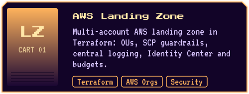</a>
<a href="https://github.com/andresazcona/k8s-gitops-platform">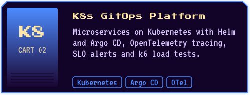</a>
<a href="https://github.com/andresazcona/sqlhelper-platform">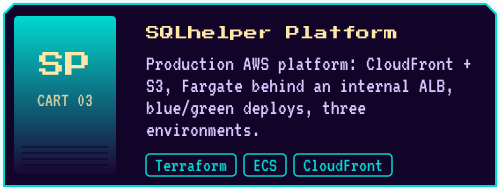</a>
<a href="https://github.com/andresazcona/flatpdf">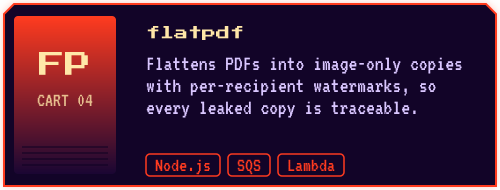</a>
<a href="https://github.com/andresazcona/cost-sentinel">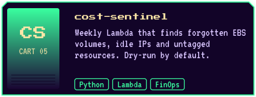</a>
<a href="https://github.com/andresazcona/system-design-casebook">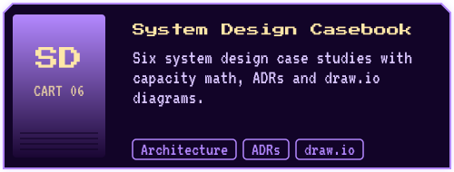</a>

 

<a href="https://github.com/andresazcona/architecture-comparison">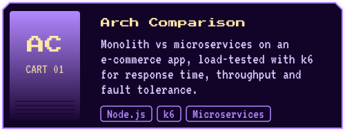</a>
<a href="https://github.com/andresazcona/SQLhelper">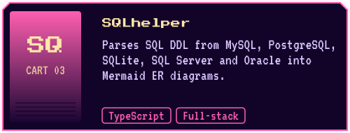</a>
<a href="https://github.com/andresazcona/IP-Tracker">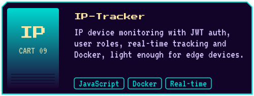</a>
<a href="https://github.com/andresazcona/NumConvert">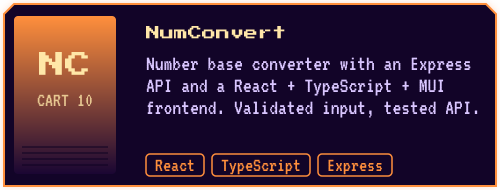</a>
<a href="https://github.com/andresazcona/geoflux_sorter_project">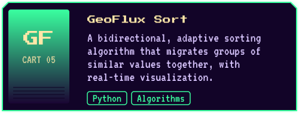</a>
<a href="https://andresazcona.github.io/nordmar-kitchens/">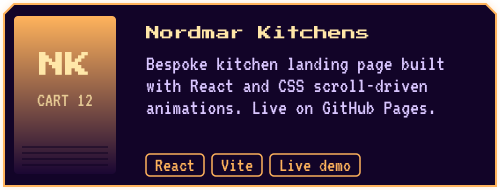</a>

 


 


